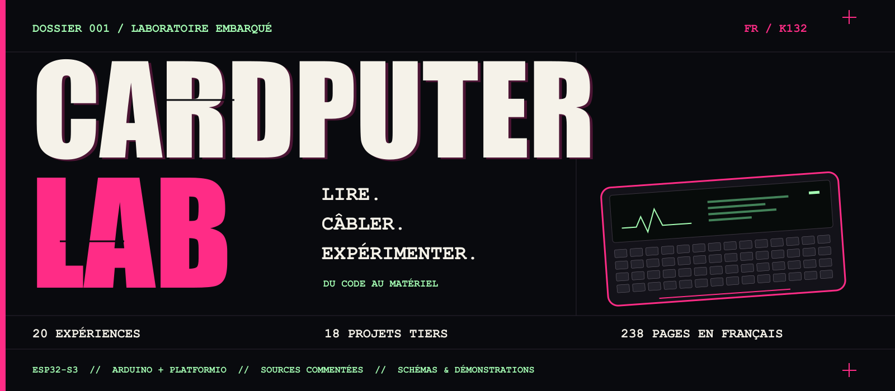
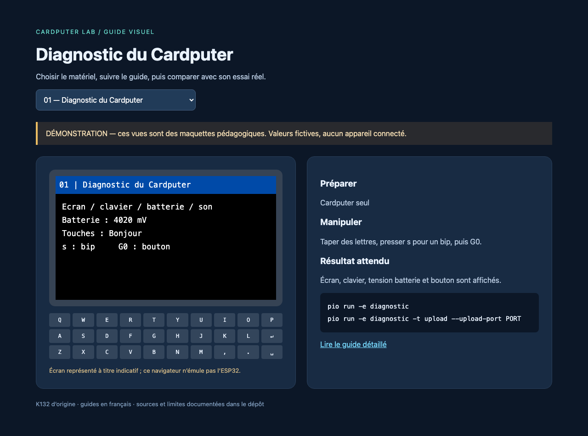
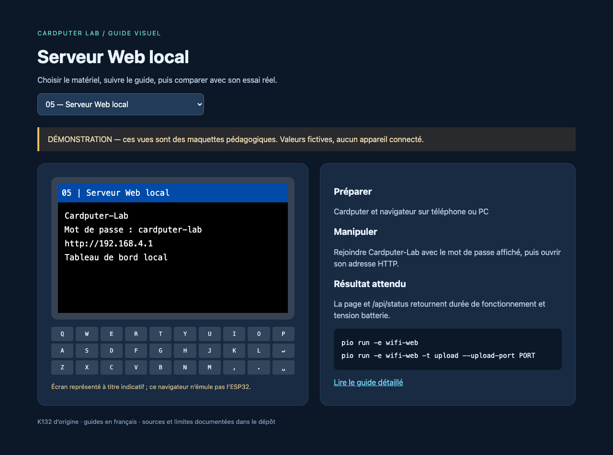
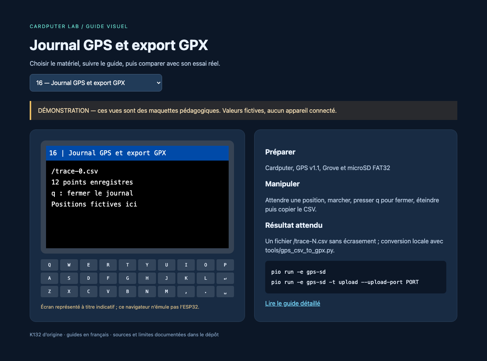

# Cardputer Lab

**Un laboratoire embarqué à explorer, une expérience à la fois.**

Écran, clavier, audio, Wi-Fi, BLE, infrarouge, RFID, RF433 et GPS : ce projet accompagne la découverte du **M5Stack Cardputer K132 d’origine**, avec du code commenté en français, des schémas de raccordement et des démonstrations expliquées. Il réunit **20 programmes indépendants**, **18 projets tiers à révision figée** et un **guide PDF illustré de 238 pages**.

**[Démarrer](docs/installation.md)** · **[Les 20 expériences](experiments/README.md)** · **[Lire le guide PDF](output/pdf/Cardputer-Guide-complet-FR.pdf)** · **[Explorer les sources](docs/code/README.md)** · **[Publier sur GitHub](docs/publication/README.md)**

| Cible | Environnement | Documentation | État vérifié |
|---|---|---|---|
| Cardputer K132 · ESP32-S3 | Arduino · PlatformIO | Français · schémas · captures | 20/20 compilations locales, le 17/10/2026 |

> **Statut du projet.** Les programmes actifs compilent et les tests sur ordinateur passent. Les essais sur matériel restent à réaliser. Les vues de démonstration ci-dessous sont des aperçus pédagogiques ; les [preuves et limites](docs/validation.md) précisent ce qui a été vérifié.

## 01 / Prise en main

Prévoir un Cardputer K132, un câble USB de données et **Python 3.12 ou plus récent**. Suivre le [guide d’installation](docs/installation.md) pour les pilotes, le port série et les différences entre systèmes.

```sh
# Depuis le dossier du projet : créer et activer l’environnement Python.
python3 -m venv .venv
source .venv/bin/activate

# Installer PlatformIO et restaurer les 18 instantanés documentés.
python -m pip install -r requirements.txt
python tools/fetch_upstream.py

# Compiler le diagnostic, puis repérer le port du Cardputer.
pio run -e diagnostic
pio device list
```

Sur **Windows / PowerShell**, utiliser `py -3 -m venv .venv`, puis `.venv\Scripts\Activate.ps1` pour les deux premières commandes. Le premier téléchargement des sources représente environ **548 Mo d’archives (523 Mio)**, auxquels s’ajoutent leur extraction et la chaîne de compilation.

Une fois le port identifié, remplacer `PORT` dans ces commandes :

```sh
pio run -e diagnostic -t upload --upload-port PORT
pio device monitor --port PORT
```

Le téléversement remplace le programme présent sur la carte. Le [diagnostic](experiments/01-diagnostic/README.md) permet ensuite de contrôler l’écran, le clavier et le son. Pour continuer, choisir une expérience et raccorder **un seul module Grove à la fois**, selon son schéma.

## 02 / À l’écran

| Diagnostic | Serveur Web local | Journal GPS |
|:---:|:---:|:---:|
| [](experiments/01-diagnostic/README.md) | [](experiments/05-wifi-web/README.md) | [](experiments/16-gps-sd/README.md) |
| Écran · clavier · audio | Réseau de test · navigateur | Positions · microSD · GPX |

Les [16 captures](docs/assets/captures/README.md) présentent des données fictives. Les [9 schémas](docs/assets/schemas/README.md) détaillent les raccordements. Sur ordinateur, ouvrir [l’aperçu des expériences](tools/apercu.html), le [simulateur OOK / FSK / FM](tools/modulation.html) ou les [trois ateliers Web fictifs](docs/ateliers/portails-fictifs/README.md) dans un navigateur après téléchargement du projet.

## 03 / Vingt expériences, six parcours

| Parcours | Programmes | Matériel principal |
|---|---|---|
| **Prendre la carte en main** | 01 Diagnostic · 02 Notes SD · 03 Micro/WAV · 18 Clavier USB | Cardputer ; microSD pour les fichiers persistants |
| **Explorer les communications** | 04 Scan Wi-Fi · 05 Web local · 06 Scan BLE · 07 Balise BLE · 17 ESP-NOW | Cardputer ; deuxième station pour ESP-NOW |
| **Mesurer en infrarouge** | 08 Télécommande IR · 10 Capteur réflectif | Émetteur intégré ; U175 pour les mesures |
| **Comprendre la radio 433 MHz** | 11 Réception RF433 · 12 Émission de trames de test | Récepteur RF433 · SYN115 · station de test |
| **Lire des cartes et des positions** | 09 Scan I²C · 13 UID RFID · 14 Bloc RFID · 15 GPS · 16 GPS/SD | RFID Unit 2 / F08 · GPS AT6668 |
| **Ajouter des modules** | 19 Radio FM · 20 Liaison NRF24 | RDA5807 ou deux NRF24 ; adaptations supplémentaires |

Chaque [fiche du catalogue](experiments/README.md) donne le matériel, les commandes PlatformIO, les commandes au clavier, le résultat attendu et l’explication du programme. Compiler un autre parcours revient à choisir son environnement, par exemple :

```sh
pio run -e wifi-web
pio run -e rfid-uid
pio run -e gps-sd
```

Les **19 dossiers historiques avec soulignés** (`01_diagnostic`, etc.) sont conservés et documentés comme brouillons. Les **20 dossiers actifs avec tirets** (`01-diagnostic`, etc.) constituent le parcours compilé. Voir la [compatibilité](docs/compatibilite.md) avant d’utiliser un autre modèle de Cardputer ou un module additionnel.

<details>
<summary><strong>Les huit équipements du laboratoire</strong></summary>

| Équipement | Documentation de raccordement et d’utilisation |
|---|---|
| Cardputer K132 | [Écran, clavier, audio, microSD, USB et radios](docs/composants/cardputer.md) |
| Câble Grove HY2.0 à quatre fils | [Broches, couleurs et signaux](docs/composants/cable-grove.md) |
| Émetteur RF433 SYN115 | [Montage et trames de laboratoire](docs/composants/rf433-emetteur.md) |
| Récepteur RF433 | [Réception et limites des protocoles](docs/composants/rf433-recepteur.md) |
| Cartes RFID F08 | [UID, mémoire et bloc de test](docs/composants/cartes-f08.md) |
| Capteur IR réflectif U175 | [Mesures, seuil et comptage](docs/composants/ir-reflectif.md) |
| RFID Unit 2 WS1850S | [Bus I²C et initialisation](docs/composants/rfid2.md) |
| GPS/BDS v1.1 AT6668 | [Position, heure UTC et traces](docs/composants/gps-at6668.md) |

La [FM](docs/experiences/fm.md) et le [NRF24](docs/experiences/nrf24.md) nécessitent des composants absents de cet inventaire. L’ESP32-S3 prend en charge le BLE, sans Bluetooth Classic/A2DP. Les expériences radio et RFID sont prévues pour vos équipements et vos cartes de test.

</details>

## 04 / La documentation fait partie du code

**[Ouvrir le guide complet en français →](output/pdf/Cardputer-Guide-complet-FR.pdf)**

238 pages · 63 figures · 132 signets · inventaires joints au PDF.

Le guide couvre les expériences, les variantes historiques, les projets tiers et les applications MicroHydra. C’est une édition datée du 17 octobre 2026, antérieure à l’ajout massif des commentaires : les README du dépôt décrivent l’état courant. Le [générateur PDF](tools/guide_pdf/README.md) explique comment préparer une nouvelle édition.

| Pour… | Ouvrir… |
|---|---|
| Installer et résoudre un problème | [Installation](docs/installation.md) · [Dépannage](docs/depannage.md) |
| Comprendre les programmes et les ajouts français | [Bilan documentaire](docs/code/README.md) · [Bibliothèques](lib/README.md) · [Paramètres](include/README.md) |
| Utiliser les outils sur ordinateur | [Scripts et aperçus](tools/README.md) · [Tests](tests/README.md) · [Données fictives](fixtures/README.md) |
| Retrouver les choix du projet | [Cahier des charges](project-specifications.md) · [État du projet](docs/etat-projet.md) |
| Préparer son dépôt distant | [Publication manuelle sur GitHub](docs/publication/README.md) |

## 05 / Dix-huit projets tiers, une provenance traçable

M5Cardputer, M5Unified, M5GFX, Cardputer Demo, M5Unit-RFID, MFRC522-I2C, TinyGPSPlus, rc-switch, IRremoteESP8266, RF24, RF24Network, RDA5807, M5Launcher, Bruce, Evil-Cardputer, ESP32-Bus-Pirate, MicroHydra et MicroHydra Apps sont référencés dans le [catalogue amont](upstream/README.md).

Le dépôt conserve leurs **commits et empreintes** dans un [manifeste](upstream/manifest.json). Les caches `upstream/archives/` et `upstream/sources/` sont recréés par `fetch_upstream.py` après le téléchargement du projet ; leurs fichiers ne sont pas inclus dans le dépôt GitHub. Les liens vers ces sources deviennent utilisables dans la copie locale après cette restauration.

Les ajouts français — **4 613 fichiers sources/configurations commentés et 1 125 README tiers** — sont distribués dans un [registre réversible](upstream/documentation-fr/README.md). Les archives d’origine et les notices des auteurs sont conservées. Les firmwares tiers ont leurs propres prérequis ; leur présence au catalogue ne signifie pas qu’ils ont tous été compilés ou essayés.

## 06 / Vérifier et contribuer

Après restauration des sources, lancer depuis la racine :

```sh
python tools/check_docs.py
python tools/check_documentation.py
python tools/fetch_upstream.py --verify
python tools/test_host.py
python tools/build_all.py
```

Les [preuves locales](docs/code/rapports/README.md) consignent **20 compilations réussies le 17 octobre 2026**. Les tests vérifient notamment les formats WAV, RFID et ESP-NOW, la conversion GPX et la réversibilité des commentaires. La [CI GitHub Actions](.github/workflows/README.md) reprend les contrôles lors d’un push ou d’une pull request ; aucune exécution distante n’est encore attestée.

Pour contribuer, lire [CONTRIBUTING.md](CONTRIBUTING.md), préciser le modèle exact et distinguer résultat attendu, observation réelle et point non testé. Les modèles d’issue et de pull request aident à fournir ces informations.

```text
docs/          Guides, captures, schémas et preuves de validation
experiments/   20 programmes actifs et 19 brouillons documentés
include/ lib/  Paramètres, interface commune et adaptation RFID
upstream/      Catalogue, manifeste et ajouts documentaires réversibles
tools/         Restauration, tests, compilation, visuels et export GitHub
tests/         Tests exécutables sur ordinateur
fixtures/      Données d’exemple fictives
output/pdf/    Guide illustré en français
.github/       Vérifications et modèles de contribution
```

---

**Cardputer Lab** est un projet pédagogique indépendant. Les créations originales sont sous [licence MIT](LICENSE) ; les composants tiers conservent leurs [auteurs et licences](THIRD_PARTY.md). [Identité visuelle et sources du design](docs/assets/identite/README.md).
