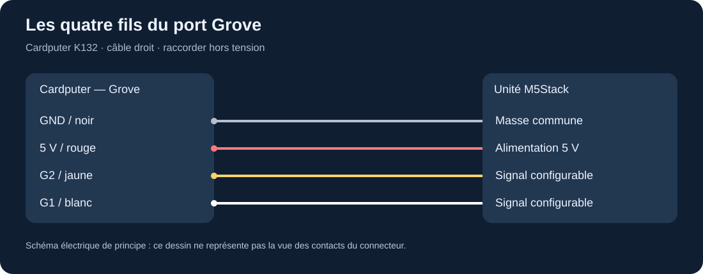

# Câble Grove HY2.0 à quatre fils

Le câble du [lien fourni](https://shop.m5stack.com/products/4pin-buckled-grove-cable) relie les unités M5Stack par quatre conducteurs. La page actuelle le présente sous un intitulé « Unbuckled » : contrôler le détrompeur du câble réellement possédé au lieu de déduire sa forme de l'URL historique.

## Raccordement

Éteindre le Cardputer et débrancher l'USB pendant le branchement. Aligner les connecteurs sans forcer, tenir le boîtier du connecteur et éviter de tirer sur les fils. Les schémas ci-dessous indiquent des **liaisons électriques**, pas une vue des contacts permettant de deviner la gauche et la droite d'un connecteur retourné.

| Fil | Cardputer | RF433T | RF433R | RFID2 | Réflectif U175 | GPS v1.1 |
|---|---|---|---|---|---|---|
| Noir | GND | GND | GND | GND | GND | GND |
| Rouge | 5 V | 5 V | 5 V | 5 V | 5 V | 5 V |
| Jaune | G2 | Entrée TX | Non connecté | SDA | Sortie numérique DO | **RX du module** |
| Blanc | G1 | Non connecté | Sortie RX | SCL | Sortie analogique AO | **TX du module** |

Pour le GPS, cela donne **RX du Cardputer = G1**, **TX du Cardputer = G2**. Le câble est droit : les rôles TX/RX se croisent parce qu'une sortie du module alimente une entrée du contrôleur.

Les couleurs des ports M5Stack A/B/C décrivent des usages typiques ; le port du Cardputer est configurable par logiciel. Installer un programme I²C ne convient pas à un GPS UART, même si les prises se ressemblent.

## Vérifier le câble

1. Débrancher les deux extrémités et vérifier visuellement l'absence de fil pincé.
2. Si un multimètre est disponible, vérifier la continuité de chaque couleur et l'absence de court-circuit entre rouge et noir, toujours hors tension.
3. Connecter le RFID2 et lancer `i2c-scan`. Une réponse à `0x28` confirme ce montage I²C ; elle ne teste pas tous les autres protocoles.
4. En cas d'absence, essayer un second câble connu et contrôler le brochage dans [la matrice](../compatibilite.md).

## Plusieurs modules

Avec un seul câble droit, choisir un module à la fois. Un séparateur passif en Y distribue les mêmes signaux ; il n'ajoute aucun GPIO. Ne pas raccorder ensemble deux sorties actives sur G1/G2. Un montage RF433 émission/réception commun nécessite des fils ou un adaptateur approprié ; la transmission simultanée masque généralement la réception proche.

Un module NRF24 nu n'accepte pas l'alimentation Grove 5 V. Le [montage NRF24](../experiences/nrf24.md) ajoute un régulateur et accède séparément au bus SPI. Ne pas insérer un connecteur ressemblant à du Grove si son brochage n'a pas été contrôlé.

Références : [brochage du Cardputer](https://docs.m5stack.com/en/core/Cardputer), puis les pages fabricant des unités liées dans leurs guides respectifs.
