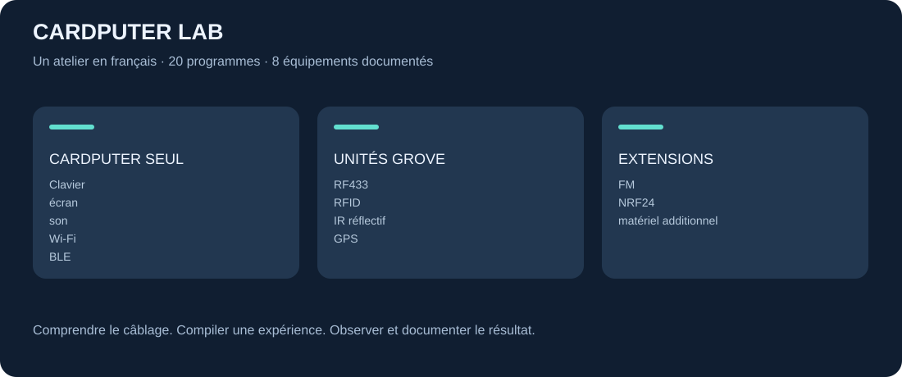

# Cardputer K132 : installation et utilisation

Le Cardputer combine un ESP32-S3, un écran de 240 × 135 pixels, un clavier de 56 touches, un microphone, un haut-parleur, une LED IR, un logement microSD et un port Grove. Le [fabricant](https://docs.m5stack.com/en/core/Cardputer) décrit 8 Mo de flash et deux batteries de 120 et 1 400 mAh. Ces caractéristiques concernent le K132 du cahier des charges.

## Raccorder et installer

Utiliser l'USB-C pour les données et l'alimentation, puis suivre [l'installation commune](../installation.md). L'interrupteur doit être sur ON pour la charge. Le mode téléchargement utilise G0 maintenu pendant la mise sous tension. Le premier programme conseillé est [01-diagnostic](../../experiments/01-diagnostic/README.md).

| Périphérique | Broches du K132 |
|---|---|
| Grove | Jaune G2 ; blanc G1 ; rouge 5 V ; noir GND |
| LED infrarouge | G44 |
| microSD | CS G12, MOSI G14, SCK G40, MISO G39 |
| Microphone | Données G46, horloge G43 |
| Haut-parleur | BCLK G41, données G42, LRCLK G43 |
| Écran | G33–G38 ; gestion par M5GFX |

Les E/S du microcontrôleur travaillent en logique 3,3 V ; le fil rouge Grove distribue une alimentation 5 V. Ne pas confondre les deux. Les broches du clavier et de l'écran ne sont pas des sorties libres pour ajouter un module.

## Parcours d'utilisation

1. **Diagnostic** : vérifier les touches, le titre à l'écran, G0 et le bip `s`. Le clavier physique est QWERTY ; les guides utilisent les caractères réellement imprimés sur ses touches.
2. **Carnet** : éteindre, insérer une microSD FAT32 sauvegardée au préalable, lancer `notes-sd`, saisir une phrase puis Entrée. Éteindre avant de retirer la carte et ouvrir `notes.txt` sur le poste.
3. **Microphone** : lancer `micro-wav`, appuyer sur `r`, parler pendant une seconde puis `p`. Une microSD ajoute une sauvegarde `/micro-N.wav` sans remplacer les prises précédentes. Le micro et le haut-parleur sont utilisés successivement à cause de leurs ressources audio communes.
4. **Radios** : essayer `wifi-scan`, `wifi-web`, `ble-scan` puis `ble-balise`. Pour ESP-NOW, prévoir un second ESP32 compatible.
5. **USB** : lancer `usb-clavier`, ouvrir un éditeur de texte vide sur le poste, puis appuyer sur Entrée sur le Cardputer. Le test émet une phrase fixe. Le résultat dépend aussi de la disposition clavier du poste ; choisir US pour le comportement exact de la bibliothèque HID.
6. **IR** : renseigner le code de sa télécommande avant d'utiliser `ir-tv` ; voir [le parcours téléviseur](../experiences/television-ir.md).

## Projets et extensions

Les [exemples officiels](../../upstream/sources/m5cardputer/examples) couvrent l'affichage, le clavier, la microSD, le micro, le buzzer et l'USB. [MicroHydra](../../upstream/sources/microhydra) propose un autre environnement, basé sur MicroPython. [M5Launcher](../../upstream/sources/launcher) gère plusieurs firmwares. Ces trois parcours ont des procédures d'installation distinctes.

## Dépannage

Écran noir : vérifier l'alimentation, Reset, le modèle, puis recompiler `diagnostic`. Port USB absent : changer le câble, éviter un hub et essayer le mode G0. Son absent : vérifier que le micro est arrêté et le volume non nul. SD absente : vérifier FAT32 et les contacts, essayer une autre carte ; la fréquence SPI locale est volontairement limitée à 10 MHz. Les fautes de frappe à l'écran ne prouvent pas un défaut matériel si la disposition attendue ne correspond pas au clavier.

Pour documenter un essai réel, photographier le titre et le résultat, en indiquant la version matérielle et l'environnement compilé. Les vues incluses sont des exemples pédagogiques, pas des preuves de fonctionnement sur une carte physique.
