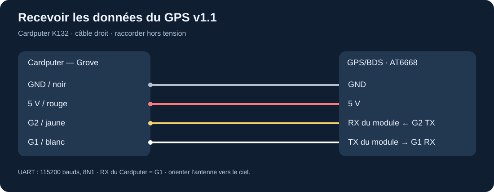
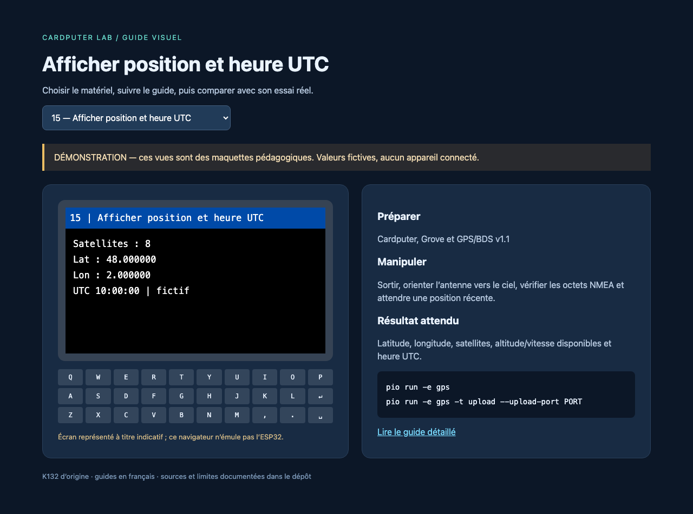

# GPS/BDS Unit v1.1 : AT6668

Le module U032-V11 fournit des phrases NMEA par UART. La [documentation du GPS v1.1](https://docs.m5stack.com/en/unit/Unit-GPS%20v1.1) indique **115200 bauds, 8N1**. Les anciennes unités AT6558 sont différentes : ne pas leur emprunter sans vérification le réglage 9600 bauds. L'AT6668 reçoit plusieurs constellations GNSS ; sa configuration active détermine les phrases effectivement émises.

## Raccordement

Éteindre le Cardputer. Brancher noir GND, rouge 5 V, jaune vers l'**entrée RX du module**, blanc depuis la **sortie TX du module**. Côté Cardputer : `HardwareSerial.begin(115200, SERIAL_8N1, 1, 2)`, donc **RX=G1** et **TX=G2**. Les noms RX/TX doivent toujours être accompagnés du point de vue du matériel concerné.



## Première position

```sh
pio run -e gps
pio run -e gps -t upload --upload-port PORT
pio device monitor --port PORT
```

Placer l'antenne céramique face au ciel à l'extérieur, sans écran métallique au-dessus. Attendre l'acquisition ; elle peut prendre nettement plus longtemps qu'une valeur typique de fiche technique en conditions défavorables.

Le compteur NMEA doit progresser même avant d'obtenir une position. L'écran affiche ensuite latitude/longitude en degrés décimaux, nombre de satellites, altitude, vitesse si disponibles et heure UTC. Une position vieille de trois secondes n'est plus présentée comme actuelle. Le nombre de satellites seul n'est pas une garantie d'exactitude.



## Enregistrer une promenade de test

Insérer une microSD FAT32 hors tension puis charger `gps-sd`. Le programme crée `/trace-N.csv` sans écraser les fichiers précédents. Une ligne par seconde au maximum est ajoutée lorsque position, date et heure sont valides et récentes. Les champs altitude/satellites restent vides si leur donnée récente manque ; une perte de fix ne produit pas de points inventés.

Appuyer sur **q** pour fermer le journal, puis éteindre avant le retrait de la SD. Copier le CSV sur l'ordinateur et convertir :

```sh
python tools/gps_csv_to_gpx.py trace-0.csv promenade.gpx
```

Le convertisseur fonctionne localement, valide les coordonnées et refuse d'écraser un fichier existant. Pour un essai sans GPS, utiliser `fixtures/trace-exemple.csv`, dont les trois points sont **fictifs**. Charger ensuite le GPX dans l'outil cartographique de son choix ; toute importation dans un service en ligne peut partager la position avec ce service.

## Expérimentations

Comparer le temps d'acquisition entre une fenêtre et un ciel dégagé ; rester dix minutes immobile pour observer la dispersion des positions ; comparer vitesse à l'arrêt et en marche ; utiliser UTC comme horloge ; dessiner un parcours GPX. Pour mesurer une distance cumulée, rejeter les sauts et le bruit à l'arrêt avant de sommer les segments.

## Diagnostic

**Aucun octet NMEA** : vérifier module v1.1, 115200 bauds, alimentation et G1/G2. **Octets présents, pas de fix** : sortir, orienter l'antenne, patienter. **Caractères illisibles** : vérifier le débit du module et du moniteur série séparément. **Position ancienne** : vérifier l'âge indiqué et la réception. **Pas de CSV** : contrôler SD et création du fichier ; l'écran signale les erreurs. Éviter les longues opérations d'affichage ou d'écriture dans une boucle qui doit vider le tampon UART.

Sources de code : [TinyGPSPlus](../../upstream/sources/tinygpsplus), plus les exemples GPS des [firmwares tiers](../experiences/firmwares.md). Ne pas publier une trace personnelle contenant son domicile dans un dépôt public.
