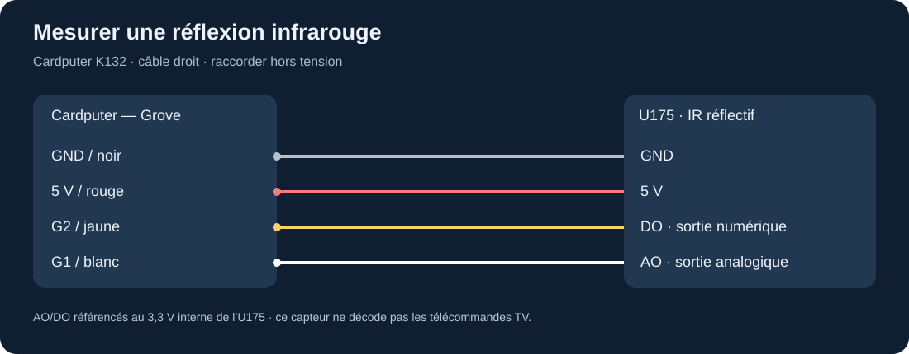
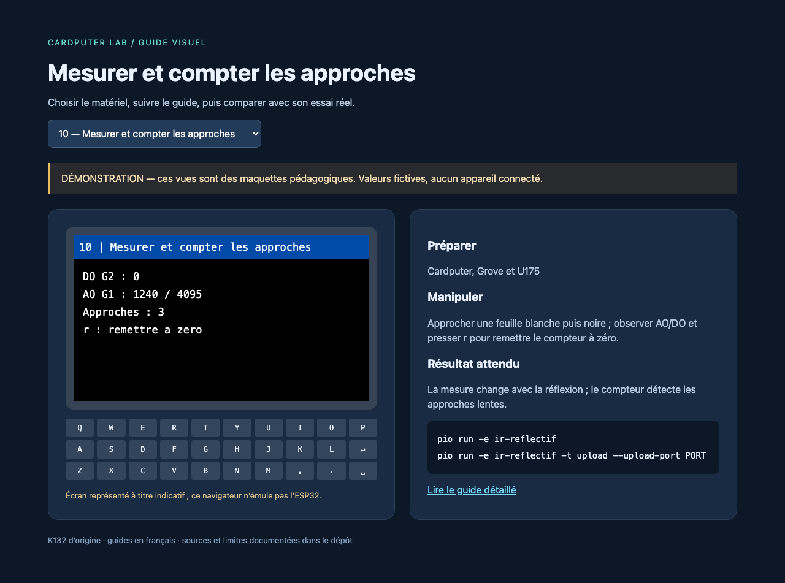

# Capteur infrarouge réflectif U175

Le U175 éclaire un objet en infrarouge et mesure la lumière réfléchie. Il fournit une sortie analogique **AO** et une sortie numérique **DO** issue d'un comparateur réglable. Il sert à observer une présence ou un contraste. Il ne décode pas les trames d'une télécommande TV. [Documentation M5Stack](https://docs.m5stack.com/en/unit/Unit_Reflective_IR).

## Installation et câblage

Après [l'installation commune](../installation.md), éteindre et connecter noir GND, rouge 5 V, **jaune DO vers G2**, **blanc AO vers G1**. Le schéma fabricant montre un régulateur interne 3,3 V et les signaux référencés à cette tension ; cette indication concerne l'U175 M5Stack, pas tous les capteurs réflectifs génériques.



```sh
pio run -e ir-reflectif
pio run -e ir-reflectif -t upload --upload-port PORT
pio device monitor --port PORT
```

## Observer puis régler

Poser le capteur sur la table sans obstacle proche. Noter AO et DO. Approcher lentement une feuille blanche, puis une surface noire, en gardant le même angle. AO change avec l'intensité reçue ; DO bas correspond au seuil de détection sur le schéma U175. La LED permet aussi d'observer ce seuil.



La mesure brute est comprise entre 0 et 4095 avec un ADC 12 bits. Une entrée proche du haut de sa plage peut saturer : ne pas transformer directement la valeur en centimètres. La couleur, la brillance, l'angle et la lumière ambiante influencent beaucoup le résultat.

Commencer avec le réglage usine. Si le seuil ne convient pas, utiliser le petit tournevis fourni et tourner légèrement le potentiomètre en observant la LED. La fiche fabricant donne une consigne de seuil autour de 1,65 V et une plage exploitable approximative de 0,3 à 2,15 V ; son inégalité imprimée est incohérente, il faut lire les bornes comme une plage, pas reproduire cette formule. Ne pas forcer les butées.

## Expériences

Le programme compte les fronts d'approche avec un filtre temporel de 100 ms ; `r` remet le compteur à zéro. Déplacer dix fois la même cible et comparer le comptage. Comparer ensuite noir/blanc à distance fixe, ou enregistrer la mesure AO dans un tableau série pour construire une courbe empirique d'une cible précise. Une roue à marques peut servir à une démonstration lente ; ce code filtré n'est pas un tachymètre de précision.

Pour une barrière de proximité, établir d'abord un seuil et une hystérésis selon l'environnement. Pour le suivi d'une ligne, un seul capteur distingue le contraste sous lui ; plusieurs capteurs et moteurs seraient nécessaires à un robot complet.

## Diagnostic

Valeur fixe : vérifier AO sur G1, la face optique et l'objet. DO fixe : ajuster doucement le seuil après avoir observé AO ; vérifier la couleur et la distance. Comptage excessif : immobiliser le montage, réduire les reflets et améliorer le filtrage. Une télécommande qui clignote ne valide pas la capacité à recevoir son protocole ; pour cela, utiliser un récepteur IR démodulé dans [le parcours TV](../experiences/television-ir.md).

Référence électrique : [schéma U175](https://m5stack-doc.oss-cn-shenzhen.aliyuncs.com/628/SCH_UNIT_Reflective_IR_V1.0_sch_01.png).
