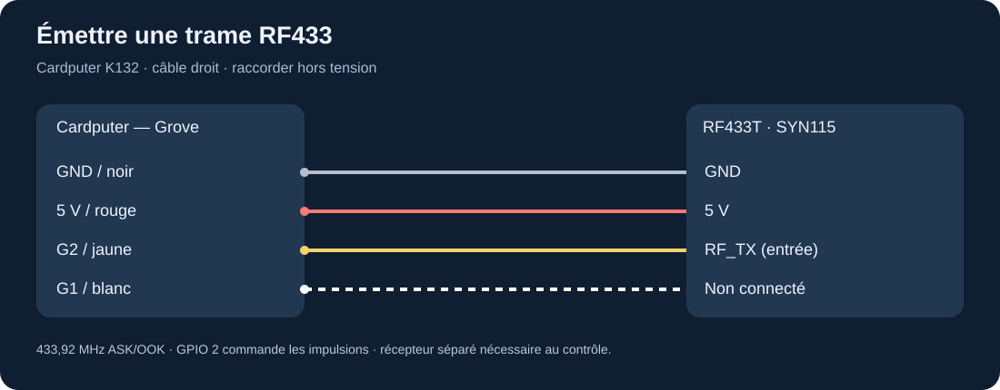
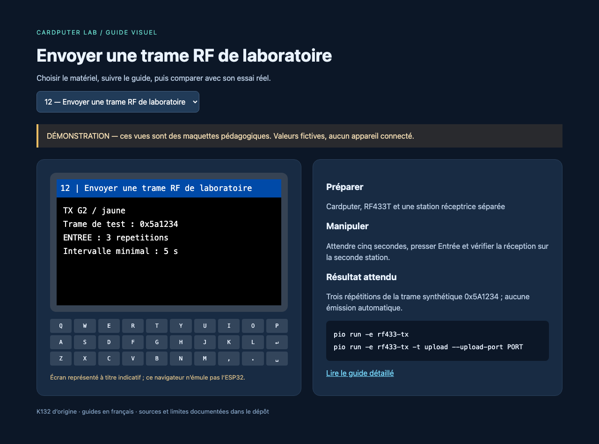

# RF433T : émetteur SYN115

Le RF433T U114 émet à **433,92 MHz**, en modulation ASK ; la commande numérique permet des trames OOK. Il ne reçoit pas. La [fiche M5Stack](https://docs.m5stack.com/en/unit/Unit_RF433T) donne une puissance nominale de 10 dBm et une antenne imprimée. Ce module ne devient ni une radio FM audio ni un CC1101 par changement de logiciel.

## Installer et raccorder

Après [l'installation](../installation.md), éteindre et connecter le module avec le câble Grove. Noir = GND, rouge = 5 V, **jaune = G2 vers RF_TX**, blanc = non connecté. L'antenne reste dégagée ; aucun réglage RF n'est nécessaire pour le test.



```sh
pio run -e rf433-tx
pio run -e rf433-tx -t upload --upload-port PORT
```

La bibliothèque [rc-switch téléchargée](../../upstream/sources/rc-switch) est sélectionnée par PlatformIO. Elle fournit des codages de télécommandes simples ; toutes les marques ne sont pas compatibles.

## Premier essai

Utiliser une seconde station de réception : un second Cardputer avec `rf433-rx`, ou un ESP32/Arduino avec le récepteur et un exemple adapté de rc-switch. Les deux unités possédées ne constituent pas à elles seules deux stations autonomes. Avec un seul Cardputer et un câble, on peut tester séparément chaque fonction avec un émetteur ou récepteur externe connu.

Attendre cinq secondes après le démarrage, puis appuyer sur Entrée. Le programme transmet trois fois **0x5A1234** sur 24 bits, protocole 1, impulsion de base 350 µs. Il ne retransmet pas automatiquement. Le récepteur compatible doit afficher la même valeur ; comparer aussi le nombre de bits et le protocole. Les répétitions ne doivent pas être comptées comme trois boutons différents.



## Expérimentations

- Changer uniquement la trame synthétique `LAB_RF_CODE`, puis vérifier sa réception.
- Faire varier la distance et l'orientation en gardant les mêmes paramètres ; relever le taux de messages décodés.
- Comparer une, trois et cinq répétitions dans un banc de test, sans émission continue.
- Ajouter un compteur de séquence dans une variante de protocole et mesurer les pertes sur deux stations.

Pour une télécommande possédée, lire d'abord [le guide badges et radio](../experiences/radio-badges.md). Un code tournant ne se reproduit pas avec une simple valeur constante.

## Diagnostic et limites

Pas de trame : vérifier **G2**, la masse commune, le protocole, le récepteur à 433,92 MHz et un écart suffisant entre antennes. Le texte « envoyée » signifie que les impulsions ont été générées ; ce n'est pas un accusé de réception radio. Aucune valeur RSSI n'est fournie par ce module.

L'usage radio doit respecter les règles applicables au lieu d'essai, à la bande, à la puissance et au temps d'émission. Le délai logiciel de cinq secondes est un réglage pédagogique, pas une attestation de conformité. Effectuer des essais brefs sur son propre banc ; consulter les [informations ANFR sur les dispositifs à courte portée](https://www.anfr.fr/) avant une utilisation durable en France.
