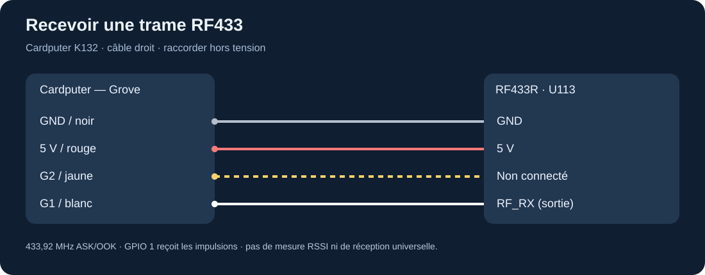
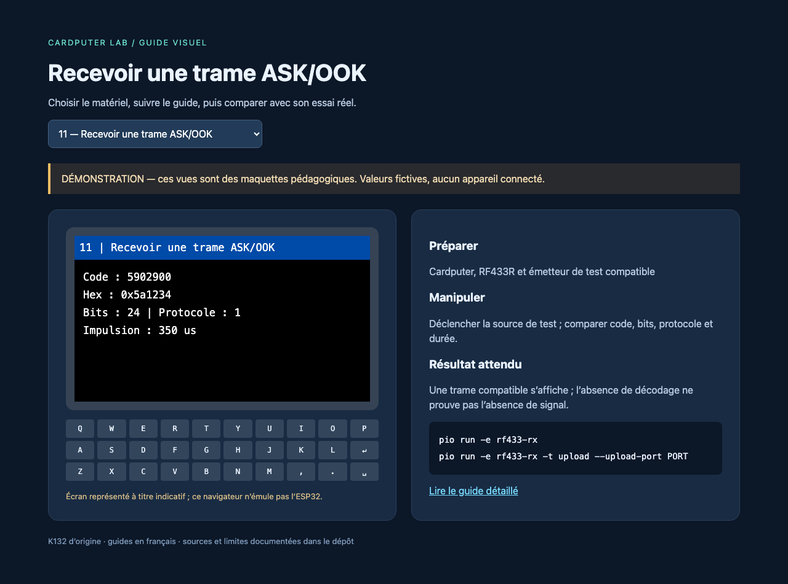

# RF433R : réception de trames à 433,92 MHz

Le lien d'achat fourni mentionne « SYN513R » ; la [documentation actuelle M5Stack](https://docs.m5stack.com/en/unit/Unit_RF433R) indique **SYN531R** pour le U113. Conserver cette distinction et relever l'inscription sur son unité. Le montage décrit utilise le brochage publié pour le RF433R M5Stack, pas celui d'une carte réceptrice nue d'une autre marque.

## Raccordement et installation

Éteindre. Brancher le Grove : noir = GND, rouge = 5 V, jaune = non connecté, **blanc = sortie RF_RX vers G1**. Reprendre [l'installation](../installation.md) si PlatformIO n'est pas prêt.



```sh
pio run -e rf433-rx
pio run -e rf433-rx -t upload --upload-port PORT
pio device monitor --port PORT --baud 115200
```

## Recevoir un premier message

L'écran attend une trame compatible. Appuyer sur une télécommande **de test que vous possédez**, ou utiliser une seconde station avec [l'émetteur du laboratoire](rf433-emetteur.md). Le code affiche la valeur décimale, l'hexadécimal, le nombre de bits, le numéro de protocole rc-switch et la durée d'impulsion estimée. Le moniteur série garde les mêmes informations.



Pour comparer deux captures, conserver l'ensemble de ces paramètres. La même valeur numérique avec un nombre de bits différent ne décrit pas nécessairement la même trame. Le récepteur délivre un signal numérique démodulé, pas un spectre ni une mesure calibrée de puissance.

## Expérimentations

Relever dix pressions du même bouton et comparer les codes. Refaire avec un autre bouton. Les écarts peuvent provenir d'un autre code fixe, de bruit, d'un protocole non pris en charge ou d'un mécanisme évolutif ; ils ne suffisent pas à identifier un chiffrement. Mesurer ensuite la proportion de pressions détectées selon l'orientation et la distance. Voir [les projets radio](../experiences/radio-badges.md) pour les extensions.

## En cas d'écran vide

Vérifier l'alimentation, G1, la fréquence et le type de modulation de la source. Un signal peut être présent mais non décodé par rc-switch. Un badge RFID à 13,56 MHz, une télécommande 868 MHz, Bluetooth ou FSK ne peut pas servir de test pour ce récepteur. Ne pas conclure que le module est défectueux sans source ASK/OOK compatible connue.

Les broches d'un ancien exemple M5Stack destiné à un autre contrôleur doivent être adaptées. Le programme local utilise `digitalPinToInterrupt(1)` pour la réception ; brancher la sortie blanche sur G2 laisse cet exemple sans signal.
