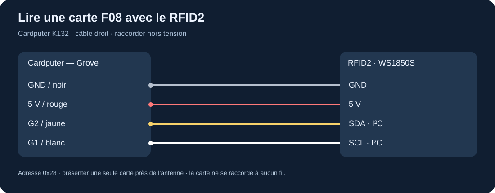
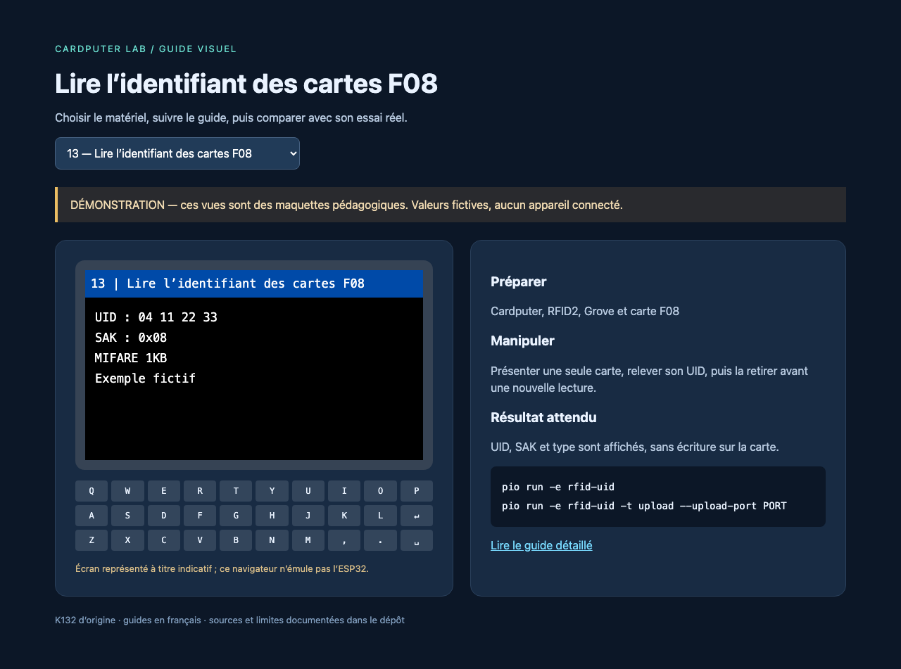

# RFID Unit 2 : WS1850S

Le RFID2 U031-B est un lecteur/écrivain **13,56 MHz** relié au contrôleur en **I²C à l'adresse 0x28**. La [fiche fabricant](https://docs.m5stack.com/en/unit/Unit_RFID2) cite les types A/B ; les programmes locaux utilisent uniquement le chemin compatible MFRC522 pour les cartes ISO14443-A, en particulier les F08. Ils ne constituent pas une implémentation générale de toutes les fonctions WS1850S.

## Installer et raccorder

Préparer PlatformIO avec [le guide commun](../installation.md), puis éteindre et brancher le câble : noir GND, rouge 5 V, jaune **SDA G2**, blanc **SCL G1**. La carte RFID se pose près de l'antenne ; elle ne se branche pas au câble.



Commencer par un contrôle du bus :

```sh
pio run -e i2c-scan -t upload --upload-port PORT
```

Attendre une réponse à `0x28`. Ensuite :

```sh
pio run -e rfid-uid -t upload --upload-port PORT
pio device monitor --port PORT
```

Le [pilote historique](../../upstream/sources/m5rfid-legacy) est conservé intact. L'adaptateur local lui fournit une initialisation I²C avec délai maximal et sans manipuler une broche RESET absente du câble. Le [projet officiel M5Unit-RFID récent](../../upstream/sources/m5rfid) est aussi téléchargé pour approfondir ; son API et ses dépendances diffèrent.

## Lire une carte

Présenter une seule F08 parallèle au lecteur et très proche, typiquement à moins de 2 cm. L'écran affiche l'UID, le SAK et le type reconnu. Retirer puis représenter la carte pour une nouvelle détection. Le lecteur arrête proprement la session après chaque lecture ; une carte maintenue immobile ne génère donc pas nécessairement des lignes en continu.



L'UID est un identifiant observable, pas une preuve cryptographique d'identité. Le lire n'implique pas que tous les blocs de mémoire soient lisibles ou modifiables. Une erreur d'authentification ne doit pas être remplacée par des essais automatiques de clés dans ce parcours.

## Écrire une donnée de laboratoire

Suivre [le guide F08](cartes-f08.md), puis charger `rfid-bloc`. Le programme lit par défaut. La touche `w` arme une écriture pendant dix secondes ; présenter ensuite une **carte de test vierge**. L'unique destination autorisée est le bloc 4, après authentification par la clé d'usine et lecture préalable. La donnée écrite est `CARDPUTER LAB FR ` sur 16 octets ; elle est relue et comparée. L'ancien contenu est affiché dans le moniteur série avant écriture.

Les blocs constructeur et trailers ne sont jamais des cibles d'écriture du programme local. L'écriture remplace néanmoins les 16 octets du bloc 4 : ne pas y présenter une carte contenant des données utiles.

## Expériences supplémentaires

Faire un inventaire des UID de ses cinq cartes sans conserver de badge personnel dans Git. Comparer portée et orientation. Créer un jeu où chaque carte correspond à une couleur affichée. Utiliser le bloc 4 comme étiquette de texte ou numéro d'inventaire. Pour étudier d'autres types de cartes, partir des exemples M5Unit-RFID avec les unités et bibliothèques qu'ils demandent.

## Diagnostic

Pas de `0x28` : vérifier l'alimentation et SDA/SCL, puis le câble. I²C présent mais pas de carte : essayer une F08 connue, retirer les autres cartes et les surfaces métalliques, approcher l'antenne. Carte détectée mais lecture du bloc refusée : la clé ou les conditions d'accès peuvent différer de l'état usine. Un badge 125 kHz ou UHF ne fonctionnera pas avec ce lecteur.
