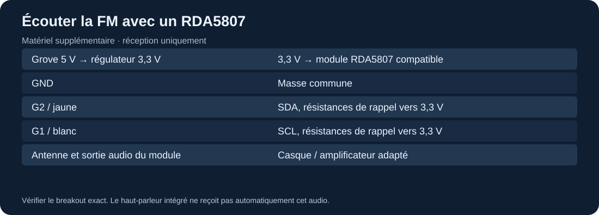

# Réception FM et modulation de fréquence

Le matériel initial ne contient aucun tuner FM. Le SYN115 est un émetteur ASK à 433,92 MHz ; il ne permet pas d'écouter la bande broadcast FM. Le programme [19-fm-rda5807](../../experiments/19-fm-rda5807/README.md) est une extension nécessitant un **RDA5807**, son antenne, une alimentation adaptée et une sortie audio externe.

## Montage additionnel

Choisir un module dont le schéma et la tension d'entrée sont connus. La puce RDA5807 nue travaille à basse tension : **ne pas relier directement VCC au fil Grove rouge 5 V**. Utiliser un régulateur 3,3 V approprié ou un breakout documenté acceptant 5 V et présentant des signaux I²C 3,3 V. Les résistances de rappel SDA/SCL doivent aboutir à 3,3 V.

Relier G2 à SDA, G1 à SCL, les masses ensemble, et l'antenne selon la carte choisie. Brancher un casque ou un amplificateur adapté sur la **sortie audio du module**, jamais sur les GPIO. L'audio n'est pas acheminé automatiquement au haut-parleur du Cardputer.

## Essai

Compiler et téléverser `fm-rda5807`. L'initialisation vérifie une réponse I²C à `0x10` ou `0x11` avant de configurer le tuner. La fréquence initiale est 99,5 MHz ; `+` et `-` la changent par pas de 0,1 MHz entre 87,5 et 108 MHz. Le programme reste en réception.

Si aucune station n'est entendue, vérifier antenne, fréquence locale, volume et câblage audio. Si le module est absent, l'écran le signale : ce message est attendu avec l'inventaire initial seul. Une compilation réussie ne remplace pas la validation électrique du breakout choisi.

Le [dépôt RDA5807 de PU2CLR](../../upstream/sources/rda5807) contient des exemples de recherche de stations, RSSI et RDS. Ils donnent des prolongements possibles après le premier montage : affichage du nom de station, comparaison stéréo/mono et mémorisation de fréquences. Adapter leur interface au Cardputer avant compilation.

## Observer une modulation sans émettre

L'[outil interactif local](../../tools/modulation.html) dessine une porteuse modulée en OOK, FSK ou FM avec des paramètres pédagogiques. L'ouvrir dans un navigateur, changer le mode et la déviation, puis comparer les tracés. Il n'utilise aucun émetteur, ne produit pas une fréquence RF réelle et n'est pas une simulation de la chaîne complète d'un récepteur.

Source technique : [documentation RDA5807](https://pu2clr.github.io/RDA5807/).
