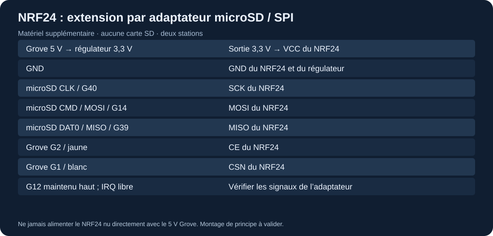

# NRF24L01+ : liaison numérique additionnelle

Le NRF24 n'est pas intégré au Cardputer. Les puces Wi-Fi/BLE ne peuvent pas exécuter à sa place le protocole RF24. Le [programme 20](../../experiments/20-nrf24/README.md) nécessite **deux stations**, chacune avec un NRF24L01+, ainsi qu'une adaptation physique du bus SPI du Cardputer d'origine.

## Matériel et câblage proposé

Prévoir un adaptateur **microSD vers fils SPI** compatible avec le logement du K132, deux NRF24L01+ standard, un régulateur 3,3 V stable et des fils courts. Une variante PA/LNA peut demander davantage de courant : commencer avec un module standard. Le montage utilise le logement microSD pour accéder au SPI et les deux GPIO Grove pour CE/CSN. **Retirer toute carte microSD ; cet exemple ne monte pas SD.**

| NRF24 | Signal côté Cardputer / adaptateur |
|---|---|
| VCC | 3,3 V régulé ; jamais Grove 5 V directement |
| GND | Masse commune |
| SCK | G40, signal CLK du logement microSD |
| MOSI | G14, signal CMD/MOSI du logement |
| MISO | G39, signal DAT0/MISO du logement |
| CE | G2, jaune Grove |
| CSN | G1, blanc Grove |
| IRQ | Non connecté dans cet exemple |

G12, sélection habituelle de SD, reste haut ; il n'est pas utilisé comme CSN du NRF24. Se fier aux **noms des signaux** de l'adaptateur, pas à une numérotation supposée de ses contacts. Vérifier continuité hors tension. Le schéma est un raccordement de principe qui reste à valider sur l'adaptateur choisi ; aucune soudure sur le Cardputer n'a été testée ici.

Mettre un découplage adapté près du NRF24, selon sa documentation. Le Grove ne fournit pas de 3,3 V dédié : son rouge 5 V peut alimenter **l'entrée du régulateur**, dont la sortie va au module. Ne pas ajouter une seconde alimentation 5 V en parallèle avec l'USB sans montage prévu pour cela.

## Essai à deux stations

Sur deux Cardputer câblés identiquement, téléverser `nrf24`. Les réglages communs sont : canal 40 (2440 MHz), 1 Mbit/s, puissance minimale, adresse `LAB01`, charge utile fixe de 16 octets, accusés matériels actifs. Chaque carte écoute. Entrée arrête brièvement l'écoute, envoie « Salut N », puis la reprend.

Le second écran doit afficher le message ; l'émetteur indique si un accusé NRF24 est revenu. Éviter d'appuyer simultanément sur les deux stations. Pour un second contrôleur différent, reprendre les mêmes paramètres dans [GettingStarted](../../upstream/sources/rf24/examples/GettingStarted) en adaptant CE/CSN et son bus SPI.

## Diagnostic et suites

« NRF24 absent » indique d'abord un problème SPI ou d'alimentation. « Pas de réponse » peut venir du canal, de l'adresse, du débit, de la taille de paquet ou de la station distante. La présence d'un module sur SPI ne prouve pas qu'il émet correctement.

Essayer ensuite numéros de séquence, mesure aller-retour et capteurs distribués avec [RF24Network](../../upstream/sources/rf24network). Ne pas employer le test comme brouilleur ou scanner large bande : l'objectif est une liaison entre vos deux stations.

Références : [brochage Cardputer](https://docs.m5stack.com/en/core/Cardputer), [documentation RF24](https://nrf24.github.io/RF24/), [câblage et dépannage RF24](https://nrf24.github.io/RF24/md_COMMON__ISSUES.html).
