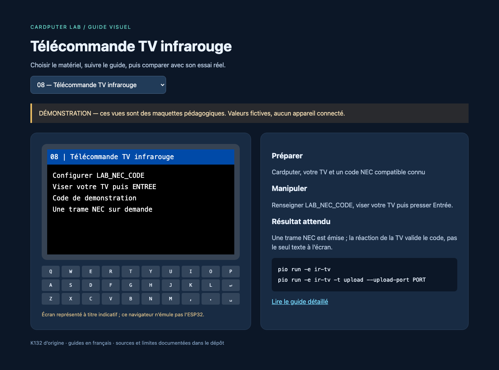

# Téléviseurs et infrarouge

## Parcours disponible avec le Cardputer seul

L'expérience [08-ir-tv](../../experiments/08-ir-tv/README.md) utilise la LED intégrée **G44** et [IRremoteESP8266](../../upstream/sources/irremote). Elle envoie une trame NEC de 32 bits après Entrée, au maximum une fois par seconde. Le code `LAB_NEC_CODE` dans [lab_config.h](../../include/lab_config.h) est un exemple : ce n'est pas un code universel.

1. Identifier le protocole et le code d'une touche de **sa propre télécommande**, par documentation ou capture avec un récepteur compatible.
2. Renseigner la valeur dans `LAB_NEC_CODE`. Les bibliothèques IR n'emploient pas toutes le même ordre de bits : conserver une valeur correspondant à `IRsend::sendNEC` d'IRremoteESP8266.
3. Compiler et téléverser `ir-tv`, viser le téléviseur, puis appuyer sur Entrée.
4. Vérifier la réaction de l'appareil. Une caméra de téléphone peut parfois montrer la LED IR, selon son filtre ; cela ne valide ni le code ni la fréquence porteuse.

## Apprendre une touche : matériel supplémentaire

Le U175 **réflectif** ne remplace pas un récepteur IR démodulé de télécommande. Ajouter un module récepteur compatible 3,3 V, typiquement prévu pour une porteuse de 38 kHz, dont le brochage et l'alimentation sont vérifiés. Sa sortie peut utiliser G1 si le Grove est disponible, avec masse commune. Alimenter le récepteur selon **sa propre fiche** : ne pas supposer qu'un composant nu accepte le 5 V du Grove.

Partir de [IRrecvDumpV2](../../upstream/sources/irremote/examples/IRrecvDumpV2), adapter la broche de réception à G1 et l'initialisation Cardputer si l'on souhaite l'écran. Cette adaptation n'est pas l'expérience compilée `ir-tv`. Capturer une pression brève, puis un appui prolongé pour distinguer la trame complète de la trame de répétition. Comparer plusieurs captures avant d'intégrer le résultat.

Pour Sony/SIRC, RC5/RC6, Samsung et d'autres protocoles, étudier les exemples et méthodes du même dépôt et remplacer l'appel d'émission. Une télécommande de climatisation transmet souvent un état complet : une seule valeur NEC ne suffit pas.

## Prolongements

Construire un menu de quelques commandes connues pour sa TV, enregistrer sa configuration sur SD, ou associer une carte F08 à une commande dans un montage adapté. [Bruce](../../upstream/sources/bruce) contient un parcours IR plus complet ; choisir sa configuration Cardputer et vérifier la compatibilité des accessoires avant installation.

Les parcours locaux déclenchent seulement une commande choisie. Aucune émission massive de codes d'arrêt de téléviseurs n'est nécessaire pour tester le matériel.
