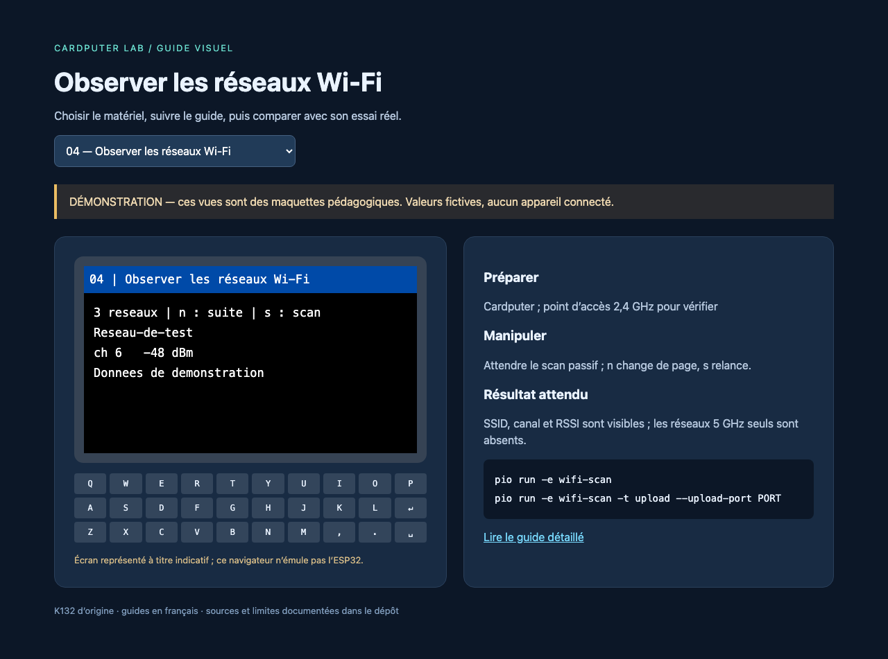

# Wi-Fi, BLE et ESP-NOW

## Observer le Wi-Fi

Charger [wifi-scan](../../experiments/04-wifi-scan/README.md). Le scan est passif et ne se connecte à aucun réseau. `s` relance une mesure ; `n` affiche les quatre résultats suivants. Le signal est donné en dBm : une valeur moins négative indique généralement une réception plus forte. Le RSSI d'une balise n'est pas une mesure globale de l'occupation du canal.

Pour une expérience reproductible, utiliser son propre point d'accès et relever son signal depuis plusieurs positions. Les SSID cachés peuvent apparaître vides, et les points d'accès exclusivement 5 GHz ne sont pas observables avec ce matériel.

## Servir une page locale

Charger [wifi-web](../../experiments/05-wifi-web/README.md). Connecter un téléphone ou ordinateur au réseau **Cardputer-Lab**, mot de passe de démonstration `cardputer-lab`. Saisir l'adresse HTTP affichée par la carte, généralement `http://192.168.4.1`. Le téléphone peut signaler l'absence d'Internet : rester connecté au réseau local pour consulter la page. Il n'y a ni portail captif ni connexion à votre routeur.

`/api/status` retourne tension batterie et durée depuis démarrage. Le mot de passe peut être changé dans `include/lab_config.h` avant compilation. Le service ne chiffre pas les échanges HTTP ; il affiche uniquement des valeurs de démonstration matérielles.

## Observer et émettre une annonce BLE

`ble-scan` écoute pendant quatre secondes, puis affiche les premiers noms et signaux ; tous les résultats vont aussi au moniteur série. `s` relance. Les annonces sans nom restent notées « sans nom » ; le scan ne se connecte pas aux périphériques. Pendant ces quatre secondes, l'exemple attend la fin du scan avant de lire le clavier.

`ble-balise` annonce **Cardputer-Lab** sans accepter de connexion. Espace arrête ou reprend l'annonce. Pour vérifier, utiliser un second Cardputer avec `ble-scan` ou un outil de scan BLE sur un téléphone. La liste Bluetooth classique des réglages du téléphone ne montre pas forcément les balises non connectables.

L'ESP32-S3 prend en charge BLE, pas Bluetooth Classic : une enceinte A2DP ou un exemple `BluetoothSerial` destiné à l'ESP32 classique n'est pas un substitut. [Référence Espressif](https://docs.espressif.com/projects/esp-idf/en/stable/esp32s3/api-guides/ble/overview.html).

## Deux cartes avec ESP-NOW

Flasher [espnow](../../experiments/17-espnow/README.md) sur deux Cardputer. Les deux emploient le canal 1 et la même structure de message. Appuyer sur Entrée sur A et lire « Bonjour du Cardputer » sur B, puis inverser. Les trames sont diffusées en clair à des fins pédagogiques. Le retour d'envoi confirme la prise en charge par le pilote, pas un accusé de lecture du pair. Le code vérifie taille, signature et terminaison du texte avant affichage.

Pour approfondir, ajouter un accusé applicatif, utiliser un destinataire unicast, puis étudier le chiffrement dans la [documentation ESP-NOW Espressif](https://docs.espressif.com/projects/esp-idf/en/stable/esp32s3/api-reference/network/esp_now.html). L'API locale est celle d'Arduino-ESP32 2.0.17 : les signatures de callbacks changent dans d'autres versions.
