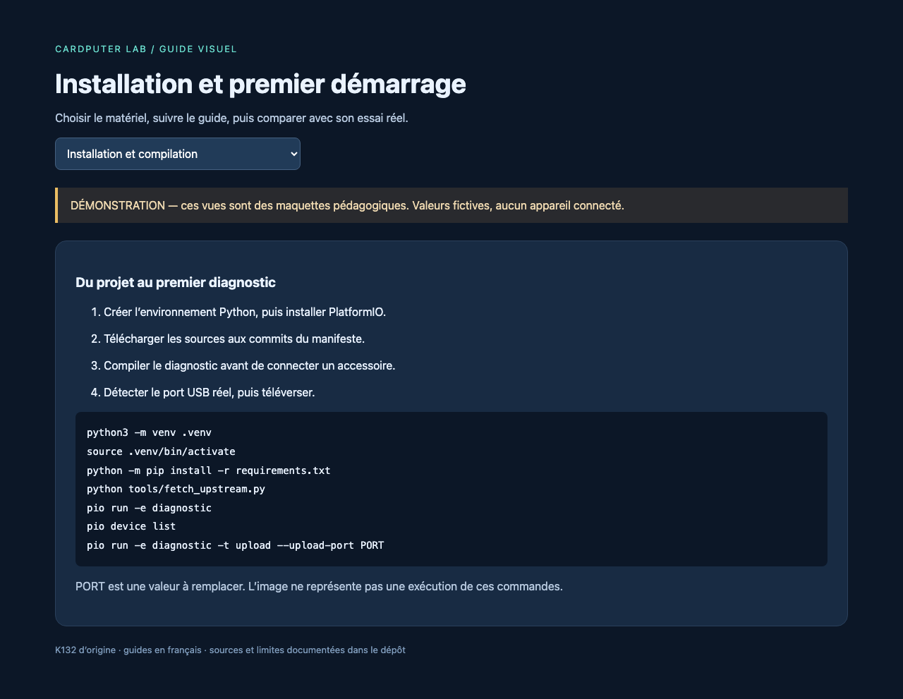

# Installation et premier démarrage

## Préparer le poste

Utiliser un Cardputer **K132** et un câble USB-C **de données**. Aucun module Grove n'est nécessaire pour le premier essai. Prévoir Python ≥ 3.12, Git si l'on clone le dépôt, un accès Internet pour le téléchargement initial et environ 10 Go libres pour les archives, outils et compilations. Le code cible Arduino-ESP32 2.0.17, via PlatformIO `espressif32@6.9.0` ; la configuration complète est dans [platformio.ini](../platformio.ini).

Ouvrir un terminal à la racine du projet :

```sh
python3 -m venv .venv
source .venv/bin/activate
python -m pip install -r requirements.txt
python tools/fetch_upstream.py
python tools/fetch_upstream.py --verify
pio run -e diagnostic
```

Windows PowerShell : employer `py -3 -m venv .venv`, puis `.venv\Scripts\Activate.ps1`. Si la politique de votre poste interdit l'activation, utiliser directement `.venv\Scripts\python.exe -m pip ...` et `.venv\Scripts\python.exe -m platformio ...`. Sur macOS/Linux, `.venv/bin/python -m platformio` fonctionne aussi sans activation.

Le script télécharge 18 dépôts avec des commits figés. Il n'exécute aucun programme contenu dans ces dépôts. PlatformIO stocke ses paquets dans `.platformio/` et les résultats dans `.pio/`. Ne pas supprimer ces dossiers entre chaque expérience : ils évitent les téléchargements inutiles.



## Connecter et téléverser

1. Débrancher les modules Grove. Connecter l'USB-C au poste.
2. Exécuter `pio device list` et repérer le nouveau port : typiquement `/dev/cu.usbmodem…` sur macOS, `/dev/ttyACM0` sur Linux ou `COM…` sur Windows. Ne pas recopier un port supposé.
3. Exécuter les commandes ci-dessous avec ce port. Elles remplacent le programme installé ; conserver votre firmware précédent si nécessaire.

```sh
pio run -e diagnostic -t upload --upload-port PORT
pio device monitor --port PORT --baud 115200
```

Quitter le moniteur série avec `Ctrl+C` avant un nouveau téléversement. Un seul logiciel peut normalement utiliser le même port série à la fois.

Si la carte ne passe pas automatiquement en mode téléchargement : mettre l'interrupteur sur OFF, maintenir **G0**, alimenter la carte puis relâcher G0. Refaire `pio device list`, car le port peut changer. La procédure OFF/G0/alimentation est donnée par [M5Stack](https://docs.m5stack.com/en/core/Cardputer). Garder l'interrupteur sur ON pour charger la batterie, selon cette même documentation.

## Premier contrôle

L'écran doit afficher `01 | Diagnostic Cardputer`. Appuyer sur des lettres, puis sur `s` : la ligne des touches change et un bref bip est demandé. G0 est également affiché. La tension batterie est une mesure indicative ; l'expérience ne promet pas une autonomie déduite de cette seule valeur.

Si le titre apparaît mais pas les touches, vérifier que le modèle est bien le Cardputer d'origine et que `M5Cardputer.begin(cfg, true)` est conservé. Si le port apparaît sans rien afficher dans le moniteur, appuyer sur Reset après l'ouverture, sans maintenir G0.

## Changer d'expérience

Les noms disponibles figurent dans le [catalogue](../experiments/README.md). Exemple RFID : éteindre, brancher le RFID2, puis compiler et téléverser `i2c-scan`. Lorsque `0x28` est détecté, passer à `rfid-uid`.

```sh
pio run -e i2c-scan
pio run -e i2c-scan -t upload --upload-port PORT
```

Chaque environnement construit **un seul programme** ; il n'y a pas de menu qui charge les vingt à la fois. Le téléversement normal de PlatformIO peut remplacer une installation M5Launcher ; le laboratoire utilise sa propre table de partitions. Pour conserver Launcher, suivre son propre processus de chargement et les formats qu'il accepte, détaillés dans [les firmwares tiers](experiences/firmwares.md).

## Variante Arduino IDE

Le parcours officiellement vérifié par compilation ici est PlatformIO. Pour découvrir l'IDE, suivre le [démarrage Arduino de M5Stack](https://docs.m5stack.com/en/arduino/m5cardputer/program), installer le paquet de cartes et M5Cardputer, puis ouvrir un exemple `Basic` de la bibliothèque. Choisir la carte Cardputer dans le paquet M5Stack. Les exemples locaux sont des fichiers C++ et partagent des en-têtes : les copier isolément dans un sketch `.ino` ne suffit pas. Conserver PlatformIO pour les exécuter tels quels.

Dans VSCodium/VS Code avec PlatformIO, ouvrir **la racine contenant `platformio.ini`**, choisir l'environnement, puis les tâches Build, Upload et Monitor. Les réglages USB de `usb-clavier` diffèrent des autres : ne pas recopier ses options vers tous les environnements.

## Sans connexion Internet après préparation

Une fois les sources et les paquets PlatformIO installés, les expériences peuvent être recompilées localement. Une nouvelle installation de poste reste dépendante des serveurs amont pour les outils. Les archives GitHub n'incluent pas automatiquement les sous-modules ni le contenu réel des pointeurs Git LFS des projets tiers.
